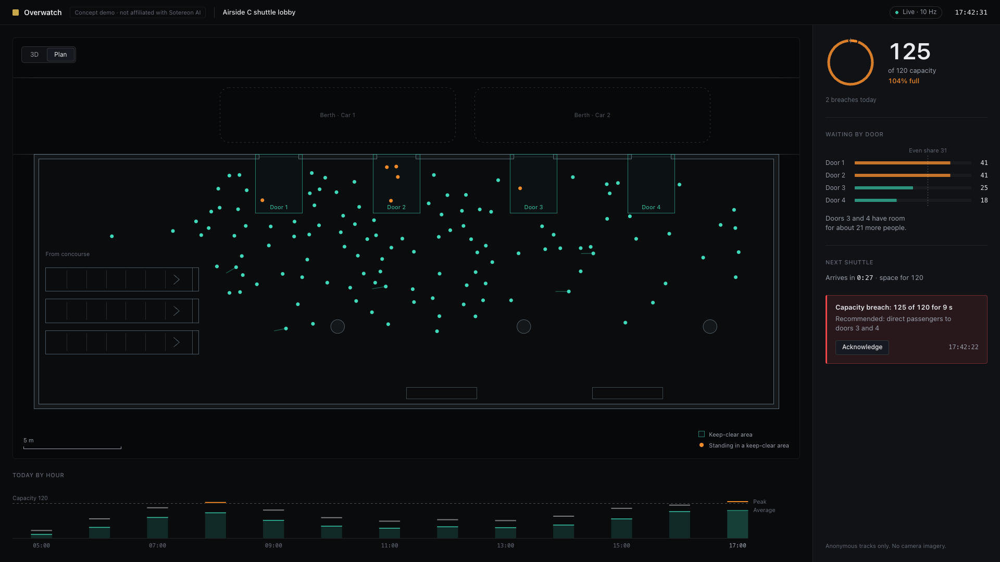
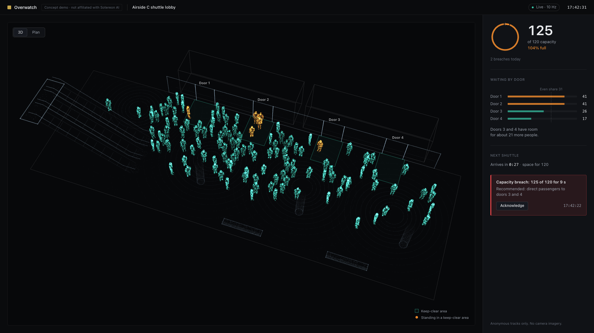

# Shuttle platform monitor (Angular concept)

One live screen for an airport shuttle platform, driven by a simulated 10 Hz stream of anonymous LiDAR-style tracks. A 2D plan view and a 3D point-cloud view share one side column: occupancy against capacity, people waiting by door, the next shuttle, and a capacity-breach alert.

Concept demo with simulated data and a fictional site. Not affiliated with or endorsed by Sotereon AI.

| Plan | 3D |
| --- | --- |
|  |  |

A 36-second walkthrough is in [docs/fasula_overwatch_3js_demo.mp4](docs/fasula_overwatch_3js_demo.mp4).

## Run it

Node 22 (see `.nvmrc`); Angular's CLI needs 22.22.3 or newer.
```sh
npm install
npm start        # http://localhost:4200/
npm test         # Vitest
```

The page opens in the 3D view. `?view=plan` (or `?view=2d`) opens the plan and `?view=3d` the 3D view; the toggle keeps the address in step, so either view can be linked to.

Optional WebSocket mode: `npm run server` starts `server/track-server.ts`, which runs the same simulator and broadcasts frames on `ws://localhost:8787`. Then open `http://localhost:4200/?ws=ws://localhost:8787`.

## How it works

```
TrackStream  (SimulatedTrackStream | WebSocketTrackStream, chosen in app.config.ts)
    │ frames$ at 10 Hz
    ▼
PlatformStore  RxJS: metrics once per frame → breach, hourly history, door advice
               signals: what templates read
    │
    ├── sections: occupancy, waiting by door, next shuttle, breach alert, hourly chart
    └── views: plan (SVG + Canvas)  |  3D (Three.js)
```
- Metrics, the breach state machine and door guidance are pure functions and reducers in `metrics/`, run with RxJS `scan` and unit tested. A breach confirms after 5 s over capacity and ends after 3 s at or under it.
- Both views use one `TrackMotion` class that interpolates position, heading and speed between 10 Hz frames for 60 fps drawing, and fades people in and out.
- `PeopleCloud` draws everyone as one `THREE.Points`, with position and colour buffers allocated once for 220 people and rewritten in place each frame.
- The 3D view sits behind `@defer`, so Three.js is a separate lazy chunk outside the initial bundle; opening with `?view=plan` does not load it until 3D is chosen.

## Plugging in real data

From `data/track.model.ts` (`ShuttleStatus` is in the same file):
```ts
export interface Track {
  id: string;
  x: number;
  y: number;
  heading: number;
  speed: number;
  firstSeen: number;
}
export interface TrackFrame {
  /** Epoch ms on the demo clock. */
  t: number;
  tracks: Track[];
  shuttle: ShuttleStatus;
}
```

Positions are metres in the platform frame from `data/platform-layout.ts`: origin at the back-wall corner on the escalator end, +x along the platform toward Door 4, +y toward the door wall; `heading` is radians from +x toward +y and `speed` is m/s.

A real feed would need to send one JSON `TrackFrame` about every 100 ms, with stable anonymous ids, positions already transformed into that frame, and a `ShuttleStatus`. The layout (doors, keep-clear lanes, capacity) would come from the real site instead of `PLATFORM_LAYOUT`. The WebSocket client (`data/websocket-track-stream.ts`) already exists and reconnects with capped exponential backoff (500 ms doubling to 8 s).

## What is simulated

- The tracks: a seeded crowd simulator in `data/simulation/`.
- The shuttle status. In a real deployment this would be a separate feed from the train control system.
- The 3D point cloud: a synthetic cluster of points drawn at each track position, not sensor returns.
- The earlier hours in the hourly chart, which are seeded.

## Performance

- 3D view, about 130 people, measured on one machine (Apple M4 Max, Chrome with Metal): average frame time 16.6 ms. Under software rendering (SwiftShader) on the same machine: 27.6 ms.
- Production build (`npm run build`): initial 244.27 kB raw / 72.25 kB transfer; lazy `platform-3d` chunk 586.65 kB raw / 122.78 kB transfer.

## Layout

```
src/app/platform/
  data/              Track model, TrackStream and its two implementations, site layout
    simulation/      seeded crowd and shuttle simulator
  metrics/           pure rules: counts, breach, door guidance, hourly history
  state/             PlatformStore, selection order, the `view` address parameter
  platform-screen/   the page: viewport, view toggle, side column
  sections/          side-column and header components, hourly chart, viewport legend
  views/
    shared/          TrackMotion, colours, hit testing
    platform-plan/   SVG plan with a Canvas people layer
    platform-3d/     Three.js scene and the people cloud
```
